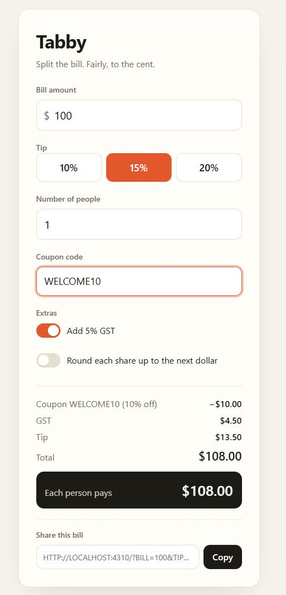
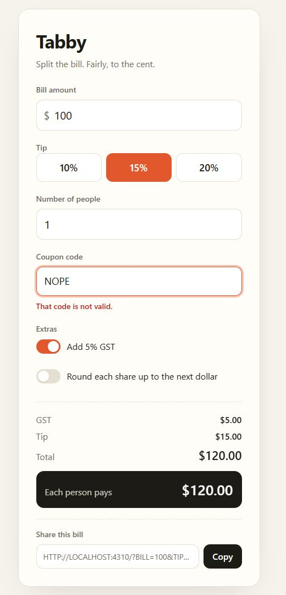

# Signoff

**Your coding agent is not done until Kane signs off.**

Coding agents say "done" when the code compiles and their own checks pass. Signoff makes "done" mean *a real browser used the app and it worked*.

When the agent tries to finish, a Stop hook runs your plain-English [Kane CLI](https://www.testmuai.com/kane-cli/) specs in Chrome. If any spec fails, the agent is **not allowed to stop**. Its next instruction is Kane's diagnosis: the bug Kane found, the root cause, the console errors and failed requests at that step, and the screenshot Kane saw. It fixes the code and tries to finish again. Kane re-runs. Repeat until Kane signs off.

```
agent: "Done. I checked five states in headless Edge and they match my hand calculations."
  │
  ▼  Stop hook ─► kane-cli testmd run signoff/*_test.md --agent      (real Chrome)
  │
  ├─ FAIL ─► the agent's next message is Kane's evidence:
  │            Bug Kane found: Invalid coupon clears the previously applied discount
  │            What Kane saw:  NOPE shows invalid, but the total changed to $120.00 rather than $108.00
  │            Root cause:     the page drops the applied coupon when a replacement is rejected
  │          agent: "Kane's finding is right." ─► fixes the code ─► tries to finish ─► Kane re-runs
  │
  └─ PASS ─► the agent may stop. A receipt records the specs, rounds, credits and Test Manager links.
```

That trace is a real run, not a mock-up: [read the full run log](docs/runs/2026-11-12-coupon.md). The agent shipped the same bug in 5 of 5 runs of this ticket, and Kane caught it every time; [the run in the demo video](docs/runs/2026-11-13-recorded-take.md) is logged minute by minute.

| Before: coupon applied, $108.00 | Kane types a bad code: message shows, discount silently gone, $120.00 |
|---|---|
|  |  |

*Kane's own screenshots from the run's evidence pack.*

> Built for the KaneCLI Online Hackathon (12 to 19 November 2026).

## Why a gate, not a skill

The Kane CLI skill lets an agent run Kane *when it decides to*. Signoff takes the decision away.

| | Agent calls Kane | **Signoff** |
|---|---|---|
| When Kane runs | when the agent chooses | every time the agent tries to finish |
| After a fail | the agent may mention it | the agent **cannot stop** until it is fixed |
| What the agent reads | the raw run | a short diagnosis built from Kane's evidence pack: triage, console, network, screenshot |
| Can the agent weaken the test? | yes | **no**: specs are locked by hash and guarded on write |
| Can the agent study the test? | yes | optional **hidden specs**: it learns only from Kane's failures |
| Proof | a run | a receipt per sign-off, a round-by-round ledger, a live timeline |

## Quick start

You need Node 18+, Chrome, [Kane CLI](https://www.npmjs.com/package/@testmuai/kane-cli) signed in, and Claude Code.

```bash
npm install -g @testmuai/kane-cli
kane-cli login
```

Then, in your project:

```bash
npx github:Automationbot24x7/kane-signoff init --url http://localhost:3000 --start "npm run dev"
```

`init` writes:

- `signoff.config.json`: where your app runs and how to start it
- `signoff/smoke_test.md`: a starter spec to edit (add more next to it)
- `.claude/settings.json`: a **Stop** hook (the gate) and a **PreToolUse** hook (the spec guard)
- `.signoff/tool/`: the gate itself, vendored into your repo with **zero dependencies**, so teammates and CI run exactly the same thing
- an `npm run signoff <command>` shortcut, if the project has a `package.json`

Sign the specs, then work as usual:

```bash
npm run signoff lock     # the specs are now the definition of done
npm run signoff view     # optional: watch each round live at http://localhost:4747
```

Ask your agent for a change. It cannot finish until Kane passes the specs.

## Try the demo

[`examples/tabby`](examples/tabby) is a small bill splitter that a coding agent built and Kane signed off. Its [brief](examples/tabby/BRIEF.md) ends with an open ticket, "Checkout extras" (GST, a coupon, round-up, a share link), and its spec for that ticket is **hidden** from the agent.

```bash
git clone https://github.com/Automationbot24x7/kane-signoff
cd kane-signoff/examples/tabby
npm run signoff check                                        # Kane fails the hidden checkout spec: the feature is not built yet
claude "Build the 'Checkout extras' described at the end of BRIEF.md."
```

The agent builds, tries to finish, and Kane decides. In [our run](docs/runs/2026-11-12-coupon.md) the agent's first version passed its own checks but failed Kane on the coupon rule. Your run may go differently: that is the point of testing in a real browser.

## Writing specs

A spec is a Kane [`_test.md`](https://github.com/LambdaTest/kane-cli/blob/main/docs/user-guide/testmd/overview.md) file: one `##` heading per step, each step a plain-English objective that ends in a check.

```markdown
---
url: http://localhost:4310
---

# Tax, coupons, rounding and sharing

## A coupon
Enter the coupon code WELCOME10 and apply it.
Verify the total shows $108.00.

## A bad coupon
Enter the coupon code NOPE and apply it.
Verify a message says the code is not valid, and the total still shows $108.00.
```

Kane caches passing steps and replays them with no AI cost, so specs that already pass re-check quickly and cheaply. In our runs a fresh spec cost 20 to 80 credits; replays cost 0.

## Hidden specs

Set `"blind": true` and the agent cannot read the specs at all (file tools, searches and shell reads are blocked). It builds from the brief and learns what it got wrong only from Kane's failures, like a hold-out test set. Without this, a capable agent simply reads the spec and codes to it. With it, Kane is checking the agent's understanding of the brief, which is where real bugs live.

## Guard rails

- **Spec lock.** `lock` records a SHA-256 of every spec and the config. If anything changes, by any route, the gate refuses to sign off and tells the agent to restore them.
- **Spec guard.** A PreToolUse hook denies edits and shell writes to the specs, `signoff.config.json`, `.signoff/` and the hook settings, so the agent cannot weaken a test, switch the gate off or forge a pass.
- **Fresh app every round.** With a `start` command, Signoff starts the app from this folder for each round and stops it afterwards. It refuses to test a server it did not start, so Kane never signs off on stale code.
- **Round cap.** After `maxRounds` (default 4) failed rounds the agent may stop, with the last report and a "not signed off" receipt.
- **Never trapped by infrastructure.** If Kane itself cannot start (exit code 2: sign-in, Chrome, network), the gate lets the agent stop and says why. It blocks only on real failures.
- **No wasted credits.** If the code is byte for byte what Kane last signed off, the gate passes without a run. If nothing changed since a failing run, it sends the same report back without spending credits.

## Commands

Run them with `npm run signoff <command>` or `node .signoff/tool/bin/kane-signoff.mjs <command>`.

| Command | What it does |
|---|---|
| `init [--url] [--start]` | wire Signoff into the project |
| `lock` | sign the current specs as the definition of done |
| `check` | run the specs now, exactly like the hook (exit 0 pass, 1 fail); works in CI |
| `view` | live round-by-round timeline at `http://localhost:4747` |
| `status` | config, specs, lock state, last sign-off |
| `off` / `on` | pause or resume the gate (humans only: the agent cannot write it) |

## Configuration (`signoff.config.json`)

| Key | Default | |
|---|---|---|
| `url` | `http://localhost:3000` | where the app answers |
| `start` | none | command that starts the app; omit it if you run the app yourself |
| `specs` | `signoff` | folder of `*_test.md` specs |
| `maxRounds` | `4` | failed rounds before the agent may stop anyway |
| `blind` | `false` | hide the specs from the agent |
| `headless` | `true` | set `false` to watch Kane drive Chrome |
| `specTimeout` | `900` | seconds per spec |

## How it works

`gate` is the Stop hook. It:

1. checks the spec lock;
2. fingerprints the code, and skips the run if Kane already signed off on exactly this code;
3. starts the app and waits until it answers;
4. runs each spec with `kane-cli testmd run <spec> --agent`, streaming Kane's NDJSON into the live timeline;
5. on a failure, opens the sealed evidence pack (a zip, read with a built-in reader) and pulls the failing step's triage (`failure.yaml`), console errors, failed network calls and screenshot;
6. returns `{"decision": "block", "reason": <diagnosis>}`, so the diagnosis becomes the agent's next instruction, or lets it stop and writes `.signoff/RECEIPT.md`.

`guard` is the PreToolUse hook that enforces the lock and hidden specs.

Zero dependencies, plain Node. Developed and tested on Windows 11 with Kane CLI 0.10.4; the macOS and Linux code paths are written but not yet tested on those systems. Run the unit tests with `npm test`.

## License

MIT
