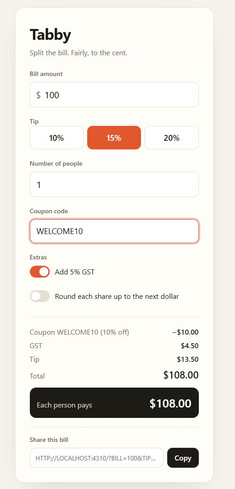
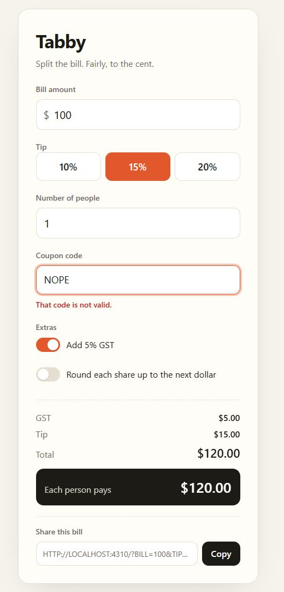

# Run log: Kane catches a coupon bug the agent's own tests missed

**Date:** 12 November 2026 · **Project:** `examples/tabby` · **Specs:** hidden from the agent (`"blind": true`)

This is a real run, kept as evidence. Nothing in it was planted: the bug below is the coding agent's own.

## The ticket

The coding agent (Claude Code, run headless with the Haiku model) got one instruction: *"Build the 'Checkout extras' described at the end of BRIEF.md."* The brief asks for GST, a `WELCOME10` coupon, round-up and a share link, and says:

> `WELCOME10` takes 10% off the bill. Any other code shows that the code is not valid and **changes nothing**.

The Kane spec `signoff/checkout_test.md` was hidden: Signoff's guard blocked the agent's attempt to `cat` it.

## Round 1: the agent says it is done

The agent built the feature, wrote its own checks in headless Edge, and reported: *"I checked the rendered numbers in headless Edge for five states and they match my hand calculations."*

It tried to stop. The Stop hook ran the three Kane specs in Chrome. Two passed. One failed:

| Before: `WELCOME10` applied | After: Kane types `NOPE` |
|---|---|
|  |  |

*Screenshots are Kane's own, taken from the run's evidence pack.*

This is exactly what the agent read next, word for word:

```
Stop hook feedback:
Kane CLI did not sign off: 1 of 3 specs failed in a real Chrome browser (round 1 of 4).

FAIL  signoff/checkout_test.md
  Kane: [A bad coupon] wait: Waiting after applying coupon code NOPE
  Kane: [A bad coupon] NOPE shows invalid, but the displayed total changed to $120.00 rather than remaining $108.00.
  Bug Kane found: Invalid coupon clears the previously applied discount (major, confidence 0.95)
  What Kane saw: NOPE shows invalid, but the displayed total changed to $120.00 rather than remaining $108.00.
  Page: http://localhost:4310/
  Kane's root cause: The page recognizes NOPE as invalid but still drops the already applied coupon discount. An invalid replacement should leave the current total at $108.00.
  Kane's suggested fix: Keep the current coupon and total unchanged when a replacement coupon is rejected, and show the invalid-code message without removing the existing discount.
  Screenshot of what Kane saw (open it): .signoff/rounds/6d62558a-r1/checkout-f856fecc-step12-annotated.png
  Evidence pack: .testmuai/evidence/fb6b23f1-1bc6-471f-9f4f-1851234f1200.evidence

PASS  signoff/edge_test.md

PASS  signoff/split_test.md

Fix the application so it does what these steps describe. The specs themselves are hidden from you on purpose
(like a hold-out test set): work from the brief and the findings above. When you have fixed it, finish again
and Kane will re-run every spec.
```

## The agent fixes it

The agent's next message:

> Kane's finding is right. The discount was derived from whatever was in the coupon box, so typing an invalid code wiped the applied discount. I'll track the applied code separately from the typed text, so only a valid code changes the discount and an empty box removes it.

It changed `public/app.js` so the discount follows the last *applied* code, not the text in the box, and tried to finish again.

## Round 2 and the sign-off

Round 2 exposed a bug in **Signoff**, not in the app: on Windows, the copy of the app that Signoff started for round 1 was not stopped (the hook exited before `taskkill` ran, and the shell's PID was already gone). Signoff correctly refused to test a server it could not vouch for, and the agent correctly refused to kill a process it had not started. We fixed Signoff (it now records and stops the process that owns the port; see `test/killtree.test.mjs`) and re-ran the gate on the agent's code:

```
Kane CLI signed off: 3/3 specs passed in a real browser. Receipt: .signoff/RECEIPT.md
```

| Spec | Result | Time | Credits |
|---|---|---|---|
| `signoff/checkout_test.md` | PASS | 275 s | 73 |
| `signoff/edge_test.md` | PASS (replayed from Kane's cache) | 60 s | 0 |
| `signoff/split_test.md` | PASS (replayed from Kane's cache) | 18 s | 0 |

The coding agent's API cost for the whole run was $0.04.
